<!-- 

We are using following structure:

    

 

    

-->

    

     
    Attempt to study <b>Java</b> itself! Some things which are <b>related</b> to advanced level!

- For these courses one should configure **GIT** for handle projects.
    - `git config --global http.postBuffer 524288000`.
    - `git config --global core.longpaths true`.

    

All course material from *Advanced Java Topics: Java Reflection - Master Class* by **Top Developer Academy LLC** and **Michael Pogrebinsky** ©. 

>. 🐟🐟🐟   
~ *DevelopersCradle*

Contains my own with my own visual notes ✍️ with some course material to enforce learning experience.

If the content sparked :fire: your interest, please consider buying the course and start learning :book:.

<!-- add this comment later 
This repository is made with , therefore it will include configuration files which are related to this IDE this approach will be favored for now. ⚙️ -->

[Course at Udemy](https://www.udemy.com/course/java-reflection-master-class/). 

[Content maker](https://topdeveloperacademy.com/).

<!-- 
Linkedin puts this shit front, when clicking from private mode x(. Need to put this to make jump working every case
?trk=public_profile_see-credential 
-->

    Insert certificate here when completed

**Note: The material provided in this repository is only for helping those who may get stuck at any point of time in the course. It is very advised that no one should just copy the solutions(violation of Honor Code) presented here.**

#### Progress/Curriculum.

- [x] [Section 01](https://github.com/developersCradle/java-advanced/tree/main/Advanced%20Java%20Topics%20Java%20Reflection%20Master%20Class/Section%2001#section-01-introduction-to-reflection) - Introduction to Reflection.
- [ ] [Section 02](https://github.com/developersCradle/java-advanced/tree/main/Advanced%20Java%20Topics%20Java%20Reflection%20Master%20Class/Section%2002#section-02-object-creation-and-constructors) - Object Creation and Constructors. ⚠️ In progress! ⚠️
- [ ] [Section 03](https://github.com/developersCradle/java-advanced/tree/main/Advanced%20Java%20Topics%20Java%20Reflection%20Master%20Class/Section%2003#section-03-inspection-of-fields--arrays) - Inspection of Fields & Arrays.
- [ ] [Section 04](https://github.com/developersCradle/java-advanced/tree/main/Advanced%20Java%20Topics%20Java%20Reflection%20Master%20Class/Section%2004#section-04-field-modification--arrays-creation) - Field Modification & Arrays Creation. 
- [ ] [Section 05](https://github.com/developersCradle/java-advanced/tree/main/Advanced%20Java%20Topics%20Java%20Reflection%20Master%20Class/Section%2005#section-05-methods-discovery--invocation) - Methods Discovery & Invocation. 
- [ ] [Section 06](#) - Java Modifiers Discovery and Analysis. 
- [ ] [Section 07](#) - Annotations with Java Reflection.
- [ ] [Section 08](#) - Dynamic Proxies.
- [ ] [Section 09](#) - Final Section: Performance, Safety and Best Practices.
- [ ] [Section 10](#) - Bonus Material.

#### Additional stuff.

- [ ] Chapters 1 and 7 for now. Related to interfaces!
- [ ] At end of this course ask yourself, "Did you develop the intuition when to use **Java reflection**"!

    

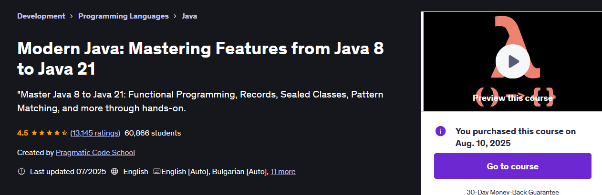

All course material from *Modern Java Mastering Features from Java 8 to Java 21* by **Pragmatic Code School** ©. 

> During a live technical demonstration at **Evitec Solutions**, I was asked to solve a puzzle involving a Java problem that required clean data processing logic. Under normal circumstances, it was a problem perfectly suited for **Java Streams**, but the pressure of the live session caused me to overlook that approach.
>
>That moment became a turning point. It pushed me to deeply pursue a course on `Modern Java`, where I strengthened my understanding of streams, functional patterns, and expressive problem-solving techniques. The experience helped me regain confidence and sharpen my ability to apply the right abstractions even in high-pressure situations.  
~ *DevelopersCradle*

Contains my own with my own visual notes ✍️ with some course material to enforce learning experience.

<!-- add this comment later 
This repository is made with , therefore it will include configuration files which are related to this IDE this approach will be favored for now. ⚙️ -->

[Course at Udemy](https://www.udemy.com/course/modern-java-learn-java-8-features-by-coding-it/). 

If the content sparked :fire: your interest, please consider buying the course and start learning :book:.

<!-- 
Linkedin puts this shit front, when clicking from private mode x(. Need to put this to make jump working every case
?trk=public_profile_see-credential 
-->

    Insert certificate here when completed

**Note: The material provided in this repository is only for helping those who may get stuck at any point of time in the course. It is very advised that no one should just copy the solutions(violation of Honor Code) presented here.**

#### Progress/Curriculum.

- [x] [Section 01](https://github.com/developersCradle/java-advanced/tree/main/Modern%20Java%20Mastering%20Features%20from%20Java%208%20to%20Java%2021/Section%2001#section-01-getting-started) - Getting Started. ✅
- [x] [Section 02](https://github.com/developersCradle/java-advanced/blob/main/Modern%20Java%20Mastering%20Features%20from%20Java%208%20to%20Java%2021/Section%2002/README.md#section-02-getting-started-modern-java) - Getting Started Modern Java. ✅
- [x] [Section 03](https://github.com/developersCradle/java-advanced/tree/main/Modern%20Java%20Mastering%20Features%20from%20Java%208%20to%20Java%2021/Section%2003#section-03-local-set-up) - Local Set Up. ✅
- [x] [Section 04](https://github.com/developersCradle/java-advanced/tree/main/Modern%20Java%20Mastering%20Features%20from%20Java%208%20to%20Java%2021/Section%2004#section-04-source-code-and-slides-for-the-course) - Source Code and Slides for the course. ✅
- [x] [Section 05](https://github.com/developersCradle/java-advanced/tree/main/Modern%20Java%20Mastering%20Features%20from%20Java%208%20to%20Java%2021/Section%2005#section-05-why-java-8) - Why Java 8? ✅
- [x] [Section 06](https://github.com/developersCradle/java-advanced/tree/main/Modern%20Java%20Mastering%20Features%20from%20Java%208%20to%20Java%2021/Section%2006#section-06-introduction-to-lambda) - Introduction to Lambda. ✅
- [x] [Section 07](https://github.com/developersCradle/java-advanced/tree/main/Modern%20Java%20Mastering%20Features%20from%20Java%208%20to%20Java%2021/Section%2007#section-07-lambdas-and-functional-interfaces) - Lambdas and Functional Interfaces. ✅
- [x] [Section 08](https://github.com/developersCradle/java-advanced/blob/main/Modern%20Java%20Mastering%20Features%20from%20Java%208%20to%20Java%2021/Section%2008/README.md#section-08-constructor-and-method-references) - Constructor and Method References. ✅
- [x] [Section 09](https://github.com/developersCradle/java-advanced/blob/main/Modern%20Java%20Mastering%20Features%20from%20Java%208%20to%20Java%2021/Section%2009/README.md#section-09-lambdas-and-local-variables-effectively-final) - Lambdas and Local variables (Effectively Final). ✅
- [ ] [Section 10](https://github.com/developersCradle/java-advanced/blob/main/Modern%20Java%20Mastering%20Features%20from%20Java%208%20to%20Java%2021/Section%2010/README.md#section-10-streams-api) - Streams API. ⚠️ In progress! ⚠️
- [ ] [Section 11](https://github.com/developersCradle/java-advanced/tree/main/Modern%20Java%20Mastering%20Features%20from%20Java%208%20to%20Java%2021/Section%2011#section-11-stream-api---operations) - Stream API - Operations.
- [ ] [Section 12](https://github.com/developersCradle/java-advanced/tree/main/Modern%20Java%20Mastering%20Features%20from%20Java%208%20to%20Java%2021/Section%2012#section-12-streams-api---factory-methods) - Streams API - Factory Methods.
- [ ] [Section 13](https://github.com/developersCradle/java-advanced/tree/main/Modern%20Java%20Mastering%20Features%20from%20Java%208%20to%20Java%2021/Section%2013#section-13-streams-api---numeric-streams) - Streams API - Numeric Streams.
- [ ] [Section 14](https://github.com/developersCradle/java-advanced/blob/main/Modern%20Java%20Mastering%20Features%20from%20Java%208%20to%20Java%2021/Section%2014/README.md#section-14-streams-api---terminal-operations) - Streams API - Terminal Operations.
- [ ] [Section 15](https://github.com/developersCradle/java-advanced/tree/main/Modern%20Java%20Mastering%20Features%20from%20Java%208%20to%20Java%2021/Section%2015#section-15-streams-api---parallel-processing) - Streams API - Parallel Processing.
- [ ] [Section 16](https://github.com/developersCradle/java-advanced/tree/main/Modern%20Java%20Mastering%20Features%20from%20Java%208%20to%20Java%2021/Section%2016#section-16-optional) - Optional.
- [ ] [Section 17](https://github.com/developersCradle/java-advanced/tree/main/Modern%20Java%20Mastering%20Features%20from%20Java%208%20to%20Java%2021/Section%2017#section-17-defaultstatic-methods-in-interfaces) - Default/Static Methods in Interfaces.
- [ ] [Section 18](https://github.com/developersCradle/java-advanced/tree/main/Modern%20Java%20Mastering%20Features%20from%20Java%208%20to%20Java%2021/Section%2018#section-18-new-datetime-apis) - New Date/Time APIs.
- [ ] [Section 19](https://github.com/developersCradle/java-advanced/tree/main/Modern%20Java%20Mastering%20Features%20from%20Java%208%20to%20Java%2021/Section%2019#section-19-base-project-setup-for-exploring-java-9-and-beyond-features) - Base Project Setup for Exploring Java 9 and Beyond Features.
- [ ] [Section 20](https://github.com/developersCradle/java-advanced/tree/main/Modern%20Java%20Mastering%20Features%20from%20Java%208%20to%20Java%2021/Section%2020#section-20-local-variable-type-inference-lvti-using-var) - Local Variable Type Inference (LVTI) using var.
- [ ] [Section 21](https://github.com/developersCradle/java-advanced/blob/main/Modern%20Java%20Mastering%20Features%20from%20Java%208%20to%20Java%2021/Section%2021/README.md#section-21-text-blocks) - Text Blocks.
- [ ] [Section 22](https://github.com/developersCradle/java-advanced/tree/main/Modern%20Java%20Mastering%20Features%20from%20Java%208%20to%20Java%2021/Section%2022#section-22-enhanced-switch) - Enhanced Switch.
- [ ] [Section 23](https://github.com/developersCradle/java-advanced/tree/main/Modern%20Java%20Mastering%20Features%20from%20Java%208%20to%20Java%2021/Section%2023#section-23-records) - Records.
- [ ] [Section 24](https://github.com/developersCradle/java-advanced/tree/main/Modern%20Java%20Mastering%20Features%20from%20Java%208%20to%20Java%2021/Section%2024#section-24-sealed-classesinterfaces) - Sealed Classes/Interfaces.
- [ ] [Section 25](#) - Pattern Matching.
- [ ] [Section 26](#) - Checkout/Service Application (Real Time Usecase).
- [ ] [Section 27](#) - Simple Web Server.
- [ ] [Section 28](#) - New Http Client.
- [ ] [Section 29](#) - Java Platform Module System (JPMS).
- [ ] [Section 30](#) - What's Next?

#### Additional stuff.

- This course uses the following repo. [Modern Java repo](https://github.com/dilipsundarraj1/modern-java).

- Use the `.gif` tool for making illustrations! Check the chapters and make GIFs out of it.
- Do again the `Optional` chapter, added it there.

- Reduce the examples in code into the dropdowns!

 <b>We will follow this project structure:</b> 

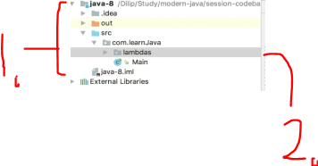

1. `java-8` is the **project** name.
2. The **individual** concept is inside **package**. Example `lambdas`.

- When the time comes, include the latest project code to projects as waterfall.

 <i>Course map for the </i><b> Modern Java Courses! </b> 

 

    

1. You can take this course first: [Modern Java - Learn Java 8 features by coding it](https://www.udemy.com/course/modern-java-learn-java-8-features-by-coding-it/).
2. You can take this course second: [Multithreading, Parallel & Asynchronous Coding in Modern Java](https://www.udemy.com/course/parallel-and-asynchronous-programming-in-modern-java/).

    

    

All course material from *Refactoring into Chain of Responsibility from Legacy Code* by **Włodek Krakowski**

> Add story here   
~ *DevelopersCradle*

Contains my own with my own visual notes ✍️ with some course material to enforce learning experience.

<!-- add this comment later 
This repository is made with , therefore it will include configuration files which are related to this IDE this approach will be favored for now. ⚙️ -->

[Course at Udemy](https://www.udemy.com/course/pyramid-of-refactoring-java-chain-of-poker-hands/). 

[Content maker](https://refactoring.pl/en/recent-posts/).

If the content sparked :fire: your interest, please consider buying the course and start learning :book:.

<!-- 
Linkedin puts this shit front, when clicking from private mode x(. Need to put this to make jump working every case
?trk=public_profile_see-credential 
-->

    Insert certificate here when completed

**Note: The material provided in this repository is only for helping those who may get stuck at any point of time in the course. It is very advised that no one should just copy the solutions(violation of Honor Code) presented here.**

#### Progress/Curriculum.

- [ ] [Section 01](#) - Course Outline. ⚠️ In progress! ⚠️
- [ ] [Section 02](#) - Introduction to the course.
- [ ] [Section 03](#) - First refactoring activities.
- [ ] [Section 04](#) - Finalize building blocks of the core logic.
- [ ] [Section 05](#) - Single Responsibility Principle - Classes.
- [ ] [Section 06](#) - Summary.

#### Additional stuff.

- [ ] todo.

# Java Best Practices: Improve Your Java Coding Standards.

    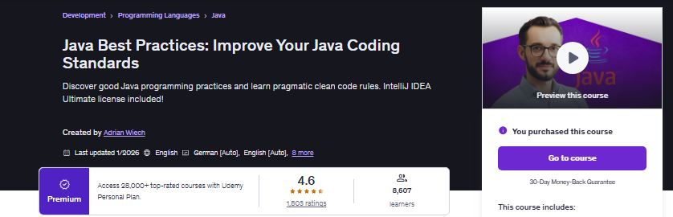

All course material from *Java Best Practices: Improve Your Java Coding Standards* by **Adrian Wiech**!

> Add story here   
~ *DevelopersCradle*

Contains my own with my own visual notes ✍️ with some course material to enforce learning experience.

<!-- add this comment later 
This repository is made with , therefore it will include configuration files which are related to this IDE this approach will be favored for now. ⚙️ -->

[Course at Udemy](https://www.udemy.com/course/java-best-practices/). 

[Content maker other homepage](https://headeasylabs.com/).

If the content sparked :fire: your interest, please consider buying the course and start learning :book:.

<!-- 
Linkedin puts this shit front, when clicking from private mode x(. Need to put this to make jump working every case
?trk=public_profile_see-credential 
-->

    Insert certificate here when completed

**Note: The material provided in this repository is only for helping those who may get stuck at any point of time in the course. It is very advised that no one should just copy the solutions(violation of Honor Code) presented here.**

#### Progress/Curriculum.

- [ ] [Section 01](#) - Introduction. ⚠️ In progress! ⚠️
- [ ] [Section 02](#) - Data Types.
- [ ] [Section 03](#) - Methods.
- [ ] [Section 04](#) - Classes and interfaces.
- [ ] [Section 05](#) - Exceptions.
- [ ] [Section 06](#) - Modern Java Elements.
- [ ] [Section 07](#) - Other.
- [ ] [Section 08](#) - Summary.

#### Additional stuff.

- [ ] todo.

    

    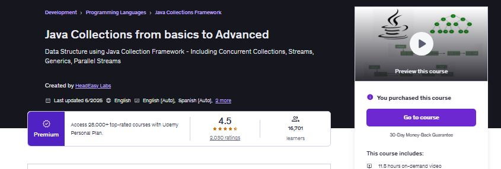

All course material from *Java Collections from basics to Advanced* by **HeadEasy Labs**!

> I once interviewed with 🌤️**Vaisala**🌤️ for the *Observation Network Manager NM10* role, where the technical discussion went deep into data structures and their operations. Although I was told beforehand that there was no particular need to prepare, the technical discussion turned out to be quite challenging. 🐟
>
> The interview challenged my understanding of trees, graphs, and time–space trade-offs in ways I hadn’t fully experienced before. [Project](https://www.vaisala.com/en/products/weather-environmental-sensors/observation-network-manager-nm10). 🐟
>
> Although I **wasn’t** selected for the position, the experience became a turning point. **It drove me** to truly internalize the concepts through a deep dive into *Java Collections from basics to Advanced*, strengthening both my problem-solving approach and technical confidence for future challenges. 🐟
>
> Looking back, that interview taught me something valuable: never underestimate the fundamentals, even when you're told there's no need to prepare. 🐟    ~ *DevelopersCradle*

Contains my own with my own visual notes ✍️ with some course material to enforce learning experience.

<!-- add this comment later check if the project needs!
This repository is made with , therefore it will include configuration files which are related to this IDE this approach will be favored for now. ⚙️ -->

[Course at Udemy](https://www.udemy.com/course/collections-and-concurrent-collection-video-lectures-and-tutorials/). 

If the content sparked :fire: your interest, please consider buying the course and start learning :book:.

<!-- 
Linkedin puts this shit front, when clicking from private mode x(. Need to put this to make jump working every case
?trk=public_profile_see-credential 
-->

    
    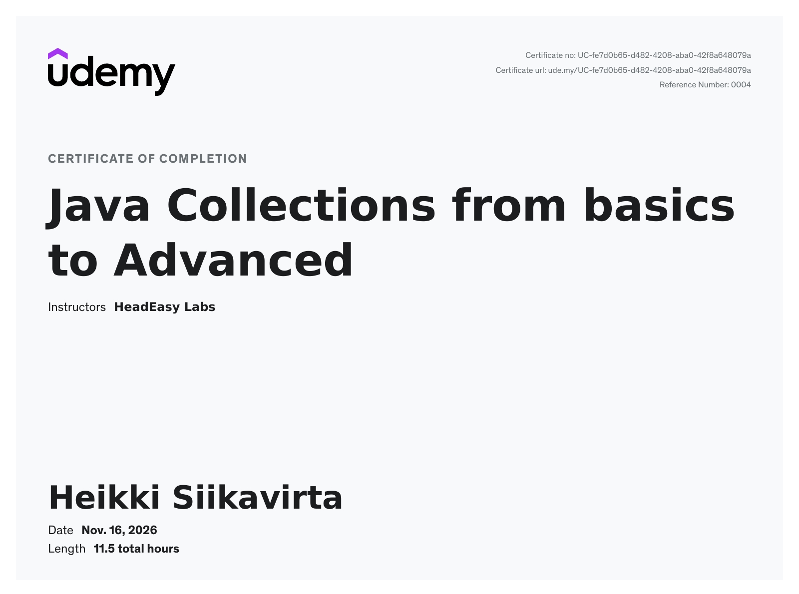

**Note: The material provided in this repository is only for helping those who may get stuck at any point of time in the course. It is very advised that no one should just copy the solutions(violation of Honor Code) presented here.**

#### Progress/Curriculum.

- [x] [Section 01](https://github.com/developersCradle/java-advanced/tree/main/Java%20Collections%20from%20basics%20to%20Advanced/Section%2001#section-01-introduction) - Introduction. ✅
- [x] [Section 02](https://github.com/developersCradle/java-advanced/tree/main/Java%20Collections%20from%20basics%20to%20Advanced/Section%2002#section-02-java-arrays-in-depth) - Java Arrays in Depth. ✅
- [x] [Section 03](https://github.com/developersCradle/java-advanced/tree/main/Java%20Collections%20from%20basics%20to%20Advanced/Section%2003#section-03-collections-overview) - Collections Overview. ✅
- [x] [Section 04](https://github.com/developersCradle/java-advanced/tree/main/Java%20Collections%20from%20basics%20to%20Advanced/Section%2004#section-04-collection-framework) - Collection Framework. ✅
- [x] [Section 05](https://github.com/developersCradle/java-advanced/tree/main/Java%20Collections%20from%20basics%20to%20Advanced/Section%2005#section-05-collection-and-collections) - Collection and Collections. ✅ 
- [x] [Section 06](https://github.com/developersCradle/java-advanced/tree/main/Java%20Collections%20from%20basics%20to%20Advanced/Section%2006#section-06-generics-overview) - Generics Overview. ✅
- [x] [Section 07](https://github.com/developersCradle/java-advanced/tree/main/Java%20Collections%20from%20basics%20to%20Advanced/Section%2007#section-07-lists-arraylist-linkedlist-vector-and-stack-and-cursors) - Lists ArrayList LinkedList Vector and Stack and Cursors. ✅
- [x] [Section 08](https://github.com/developersCradle/java-advanced/tree/main/Java%20Collections%20from%20basics%20to%20Advanced/Section%2008#section-08-set-its-implementation-class-and-more) - Set Its implementation class and more. ✅
- [x] [Section 09](https://github.com/developersCradle/java-advanced/blob/main/Java%20Collections%20from%20basics%20to%20Advanced/Section%2009/README.md#section-09-queues) - Queues. ✅
- [x] [Section 10](https://github.com/developersCradle/java-advanced/tree/main/Java%20Collections%20from%20basics%20to%20Advanced/Section%2010#section-10-maps--trees-in-depth---working-and-its-implementation-classes) - Maps & Trees in Depth - Working and its implementation classes. ✅
- [x] [Section 11](https://github.com/developersCradle/java-advanced/tree/main/Java%20Collections%20from%20basics%20to%20Advanced/Section%2011#section-11-concurrent-collections-in-depth) - Concurrent Collections in depth. ✅
- [x] [Section 12](https://github.com/developersCradle/java-advanced/tree/main/Java%20Collections%20from%20basics%20to%20Advanced/Section%2012#section-12-lambda-and-collections-in-depth) - Lambda and Collections in depth. ✅
- [x] [Section 13](#) - Streams in Depth and collections. ✅
- [x] [Section 14](#) - Generics In Depth. ✅
- [x] [Section 15](#) - Thank you! ✅

#### Additional stuff.

- [ ] Make illustration in `.gif`.
- [ ] Make summaries for each ds in the chapter!
- [ ] Finish the chapter Cursors! .
- [ ] If energy, go thought `Map Introduction` go thought the examples, and make notes of them!

- [ ] Check the [Program to interface](https://www.baeldung.com/cs/program-to-interface)

    

    

 

All course material from *Java Application Performance Tuning and Memory Management* by from **Matt Greencroft** ... Sir **Matt Greencroft** and **Virtual Pair Programmers**.

> Add here story.🐟   

Contains my own with my own visual notes ✍️ with some course material to enforce learning experience.

This repository is made with  with  hotkeys, therefore it will include configuration files which are related to this IDE this approach will be favored for now. ⚙️

We are using . Instead, the which are recommended!

[Udemy course](https://www.udemy.com/course/java-application-performance-and-memory-management).

[Homepage of maker](https://www.virtualpairprogrammers.com).

If the content sparked :fire: your interest, please consider starting the course and start learning :book:.

<!-- 
Linkedin puts this shit front, when clicking from private mode x(. Need to put this to make jump working every case
?trk=public_profile_see-credential 
-->

    
    

**Note: The material provided in this repository is only for helping those who may get stuck at any point of time in the course. It is very advised that no one should just copy the solutions(violation of Honor Code) presented here.**

#### Progress/Curriculum.

- [x] [Chapter 01](https://github.com/developersCradle/data-structures-algorithms-and-java-multithreading-concurrency-performance-optimization/tree/main/Java%20Application%20Performance%20Tuning%20and%20Memory%20Management/Section%2001#chapter-01---introduction) - Introduction. ✅
- [ ] [Chapter 02](https://github.com/developersCradle/data-structures-algorithms-and-java-multithreading-concurrency-performance-optimization/blob/main/Java%20Application%20Performance%20Tuning%20and%20Memory%20Management/Section%2002/README.md#section-02-just-in-time-compilation-and-the-code-cache) - Just In Time Compilation and the Code Cache. ⚠️ In progress! ⚠️
- [ ] [Chapter 03](https://github.com/developersCradle/data-structures-algorithms-and-java-multithreading-concurrency-performance-optimization/tree/main/Java%20Application%20Performance%20Tuning%20and%20Memory%20Management/Section%2003#chapter-03-selecting-the-jvm) - Selecting the JVM.
- [ ] [Chapter 04](https://github.com/developersCradle/data-structures-algorithms-and-java-multithreading-concurrency-performance-optimization/blob/main/Java%20Application%20Performance%20Tuning%20and%20Memo ry%20Management/Section%2004/README.md#chapter-04-how-memory-works-the-stack-and-the-heap) - How memory works: the stack and the heap.
- [ ] [Chapter 05](#) - Passing objects between methods.
- [ ] [Chapter 06](#) - Memory exercise.
- [ ] [Chapter 07](#) - Escaping References.
- [ ] [Chapter 08](#) - Memory Exercise.
- [ ] [Chapter 09](#) - The Metaspace and internal JVM memory optimisations.
- [ ] [Chapter 10](#) - Tuning the JVM’s Memory Settings.
- [ ] [Chapter 11](#) - Introducing Garbage Collection.
- [x] [Chapter 12](https://github.com/developersCradle/data-structures-algorithms-and-java-multithreading-concurrency-performance-optimization/tree/main/Java%20Application%20Performance%20Tuning%20and%20Memory%20Management/Section%2012#chapter-12---monitoring-the-heap) - Monitoring the Heap. ✅
- [x] [Chapter 13](https://github.com/developersCradle/data-structures-algorithms-and-java-multithreading-concurrency-performance-optimization/tree/main/Java%20Application%20Performance%20Tuning%20and%20Memory%20Management/Section%2013#chapter-13---analyzing-a-heap-dump) - Analyzing a heap dump. ✅
- [ ] [Chapter 14](#) - Generational Garbage Collection.
- [ ] [Chapter 15](#) - Garbage Collector tuning & selection.
- [ ] [Chapter 16](#) - Using a profiler to analyse application performance.
- [ ] [Chapter 17](#) - Assessing Performance.
- [ ] [Chapter 18](#) - Benchmarking with JMH.
- [ ] [Chapter 19](#) - Performance and Benchmarking Exercise.
- [ ] [Chapter 20](#) - How Lists Work.
- [ ] [Chapter 21](https://github.com/developersCradle/data-structures-algorithms-and-java-multithreading-concurrency-performance-optimization/tree/main/Java%20Application%20Performance%20Tuning%20and%20Memory%20Management/Section%2021#chapter-21---how-maps-work) - How Maps Work. ⚠️ In progress! ⚠️

#### Additional stuff.

- Remove the `Codes` folder after course is finished!
- [ ] Check the content from other student, if there is missing or broken material. [Link](https://github.com/tommic81/udemy-java-memory-management/tree/master).
- [ ] Heap Dump Analysis Using Eclipse MAT. [Link](Heap Dump Analysis Using Eclipse MAT).
- Do the chapters `The structure of this course`.
- Finish this after this course is finished `Solving Memory Leaks in the JVM`. (add here the link)
- [ ] Read thought. [Link](https://www.baeldung.com/java-memory-leaks).
- [ ] Check this memory leak course after this course. [Link](https://www.linkedin.com/learning/java-memory-management-garbage-collection-jvm-tuning-and-spotting-memory-leaks).
- [ ] Check second this memory leak course after this course. [Link](https://www.oreilly.com/live-events/memory-efficient-java/0636920457060/).
- [ ] Check third this memory leak course after this course. [Link](https://www.pluralsight.com/courses/java-understanding-solving-memory-problems?utm_source=chatgpt.com).
- [ ] Check Java Memory Leaks by Victor Rentea. [Link](https://www.youtube.com/watch?v=-0vkHxlGlOU).
- [ ] Check. [Link](https://www.youtube.com/watch?v=W4SvLYU9H1I&list=PLQh1c87p_Wlp7GgRQEf3907LnxxsrbX3R).

#### The Quizzes and Labs.

* **Section 01**:
    - check this one.
* **Section 02**:
    * *Example*:
        * [Performance example one codes](https://github.com/developersCradle/data-structures-algorithms-and-java-multithreading-concurrency-performance-optimization/blob/main/Java%20Application%20Performance%20Tuning%20and%20Memory%20Management/Section%2002/README.md#JIT%20logs%20example%20one%20codes).
        * [Performance example second codes](https://github.com/developersCradle/data-structures-algorithms-and-java-multithreading-concurrency-performance-optimization/blob/main/Java%20Application%20Performance%20Tuning%20and%20Memory%20Management/Section%2002/README.md#JIT%20logs%20example%20second%20codes).
        - FIx the links
    * *Logs*:
        * [Performance example second logs](https://github.com/developersCradle/data-structures-algorithms-and-java-multithreading-concurrency-performance-optimization/blob/main/Java%20Application%20Performance%20Tuning%20and%20Memory%20Management/Section%2002/README.md#JIT%20logs%20example%20second%20logs).
        * [Performance logs from the logCompilation](https://github.com/developersCradle/data-structures-algorithms-and-java-multithreading-concurrency-performance-optimization/blob/main/Java%20Application%20Performance%20Tuning%20and%20Memory%20Management/Section%2002/hotspot_pid11876.log).
        - Fix the links

    

 

    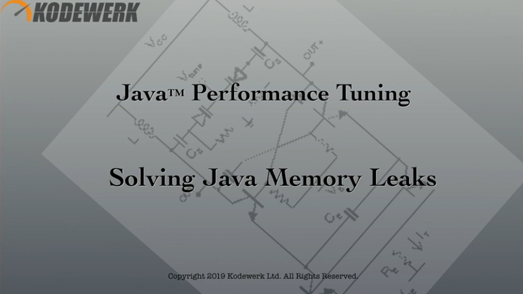

All course material from *Solving Memory Leaks in the JVM* by **Kirk Pepperdine**!

> Add story here. 🐟   
> ~ *DevelopersCradle*

Contains my own with my own visual notes ✍️ with some course material to enforce learning experience.

<!-- add this comment later 
This repository is made with , therefore it will include configuration files which are related to this IDE this approach will be favored for now. ⚙️ -->

[The series at YouTube](https://www.youtube.com/watch?v=_gineh_HcoQ). 

If the content sparked :fire: your interest, please consider buying the course and start learning :book:.

<!-- 
Linkedin puts this shit front, when clicking from private mode x(. Need to put this to make jump working every case
?trk=public_profile_see-credential 
-->

    
    

**Note: The material provided in this repository is only for helping those who may get stuck at any point of time in the course. It is very advised that no one should just copy the solutions(violation of Honor Code) presented here.**

#### Progress/Curriculum.

- [x] [Section 01](#) - ⚠️ In progress! ⚠️

#### Additional stuff.

- [ ] Todo.
    

    

    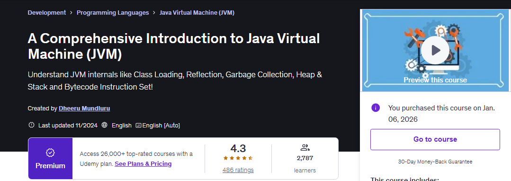

All course material from *A Comprehensive Introduction to Java Virtual Machine (JVM)* by **Dheeru Mundluru**.

> Sorry Linux for extra abstraction.
>
> Once I saw Sony's 👓<b>requirements</b>👓 in the job posting, I became more motivated to deepen my understanding of JVM internals. 🐟
>
> *"How you would tune the JVM for Garbage Collection (GC) overhead in latency-sensitive applications?"* 🐟
>
> Sony evaluates candidates on real-world scalability, debugging under pressure, and system performance rather than just "textbook answers". 🐟    ~ *DevelopersCradle*

Contains my own with my own visual notes ✍️ with some course material to enforce learning experience.

This repository is made with  with  hotkeys, therefore it will include configuration files which are related to this IDE this approach will be favored for now. ⚙️

[Course at Udemy](https://www.udemy.com/course/a-comprehensive-introduction-to-java-virtual-machine-jvm). 

[Website of maker](https://www.semanticsquare.com/).

If the content sparked :fire: your interest, please consider buying the course and start learning :book:.

<!-- 
Linkedin puts this shit front, when clicking from private mode x(. Need to put this to make jump working every case
?trk=public_profile_see-credential 
-->

    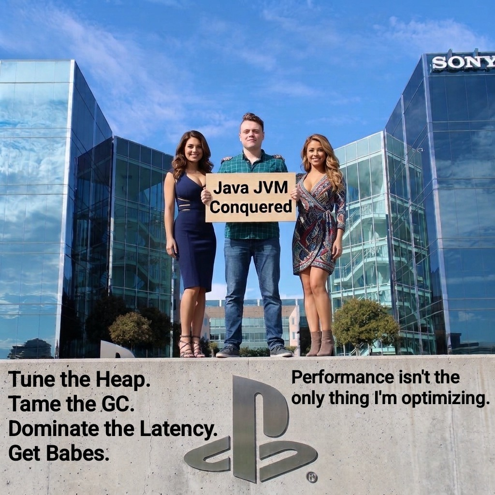
    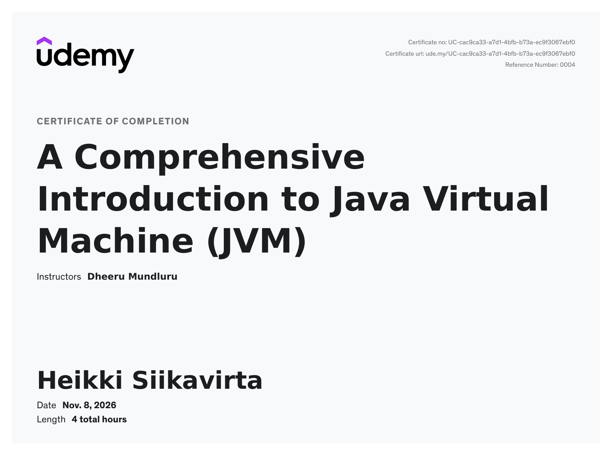

**Note: The material provided in this repository is only for helping those who may get stuck at any point of time in the course. It is very advised that no one should just copy the solutions(violation of Honor Code) presented here.**

#### Progress/Curriculum.

- [x] [Section 01](https://github.com/developersCradle/data-structures-algorithms-and-java-multithreading-concurrency-performance-optimization/tree/main/A%20Comprehensive%20Introduction%20to%20Java%20Virtual%20Machine%20(JVM)/Section%2001#chapter-01---background--a-high-level-overview-on-jvm-) - Background ~ A High-level Overview on JVM. ✅
- [x] [Section 02](https://github.com/developersCradle/data-structures-algorithms-and-java-multithreading-concurrency-performance-optimization/blob/main/A%20Comprehensive%20Introduction%20to%20Java%20Virtual%20Machine%20(JVM)/Section%2002/README.md#chapter-02---introduction-) - Lifetime of a Type. ✅
- [x] [Section 03](https://github.com/developersCradle/data-structures-algorithms-and-java-multithreading-concurrency-performance-optimization/blob/main/A%20Comprehensive%20Introduction%20to%20Java%20Virtual%20Machine%20(JVM)/Section%2003/README.md#chapter-03---reflection-) - Reflection. ✅
- [x] [Section 04](https://github.com/developersCradle/data-structures-algorithms-and-java-multithreading-concurrency-performance-optimization/tree/main/A%20Comprehensive%20Introduction%20to%20Java%20Virtual%20Machine%20(JVM)/Section%2004#chapter-04---jvm-memory-garbage-collection-and-bytecode-instructions-) - JVM Memory, Garbage Collection, and Bytecode Instructions. ✅
- [x] [Section 05](https://github.com/developersCradle/data-structures-algorithms-and-java-multithreading-concurrency-performance-optimization/tree/main/A%20Comprehensive%20Introduction%20to%20Java%20Virtual%20Machine%20(JVM)/Section%2005#chapter-05---strings--jvm-) - Strings & JVM. ✅
- [x] [Section 06](https://github.com/developersCradle/data-structures-algorithms-and-java-multithreading-concurrency-performance-optimization/tree/main/A%20Comprehensive%20Introduction%20to%20Java%20Virtual%20Machine%20(JVM)/Section%2006#chapter-06---bonus-chapter-) - Bonus Chapter. ✅

#### Additional stuff.

- [ ] After this answer, the questions from Sony!
- todo Chapter 06 - Bonus Chapter.

 <i>The requirements, which drove me to pursies this course, from <b>Sony!</b>

 

    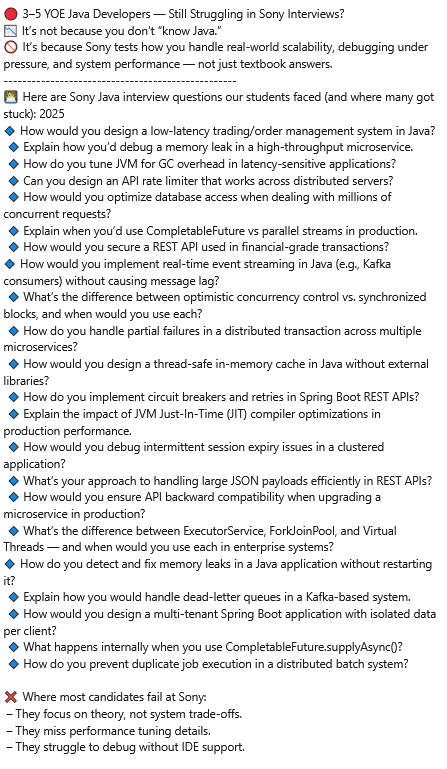

<!-- 
todo finish these ones
* **Section 02** - Lifetime of a Type.
    -->

#### The Quizzes and Labs.

* **Section 02** - Lifetime of a Type.
    * *Quiz*:
        * [Quiz 01: Chapter Quiz](#).
* **Section 03** - Reflection.
    * *Coding Exercise*:
        * [Coding Exercise 01: Simulate a Basic Unit Testing Framework ~ Putting reflection into action](#)!
* **Section 04** - JVM Memory, Garbage Collection, and Bytecode Instructions.
    * *Quiz*:
        * [Quiz 02: Chapter Quiz](#).
* **Section 05** - Strings & JVM.
    * *Quiz*:
        * [Quiz 03: Chapter Quiz](#).

<!-- 

    

 -->

# JVM ANATOMY QUARKS.

    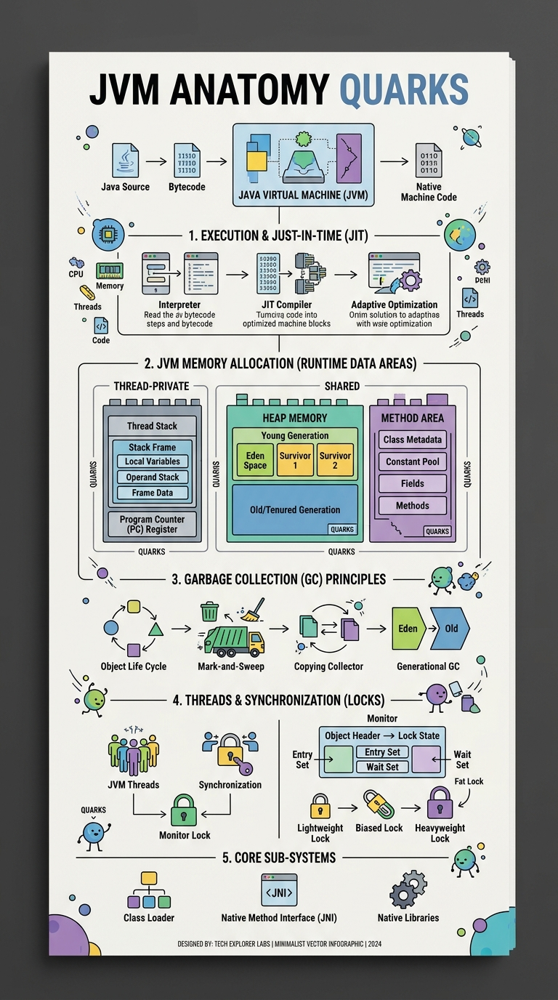

Contains my own with my own visual notes ✍️ with some course material to enforce learning experience.

[Anatomy Quarks](https://shipilev.net/jvm/anatomy-quarks/).

#### Progress/Curriculum.

- [ ] [Section 01](#) - Lock Coarsening and Loops.
- [ ] [Section 02](#) - Transparent Huge Pages.
- [ ] [Section 03](#) - GC Design and Pauses.
- [ ] [Section 04](#) - TLAB Allocation.
- [ ] [Section 05](#) - TLABs and Heap Parsability.
- [ ] [Section 06](#) - New Object Stages.
- [ ] [Section 07](#) - Object Initialization Costs.
- [ ] [Section 08](#) - Local Variable Reachability.
- [ ] [Section 09](#) - JNI Critical and GC Locker.
- [ ] [Section 10](#) - String.intern().
- [ ] [Section 11](#) - Moving GC and Locality.
- [ ] [Section 12](#) - Native Memory Tracking.
- [ ] [Section 13](#) - Intergenerational Barriers.
- [ ] [Section 14](#) - Constant Variables.
- [ ] [Section 15](#) - Just-In-Time Constants.
- [ ] [Section 16](#) - Megamorphic Virtual Calls.
- [ ] [Section 17](#) - Trust Non-Static Final Fields.
- [ ] [Section 18](#) - Scalar Replacement.
- [ ] [Section 19](#) - Lock Elision.
- [ ] [Section 20](#) - FPU Spills.
- [ ] [Section 21](#) - Heap Uncommit.
- [ ] [Section 22](#) - Safepoint Polls.
- [ ] [Section 23](#) - Compressed References.
- [ ] [Section 24](#) - Object Alignment.
- [ ] [Section 25](#) - Implicit Null Checks.
- [ ] [Section 26](#) - Identity Hash Code.
- [ ] [Section 27](#) - Compiler Blackholes.
- [ ] [Section 28](#) - Frequency-Based Code Layout.
- [ ] [Section 29](#) - Uncommon Traps.
- [ ] [Section 30](#) - Conditional Moves.

